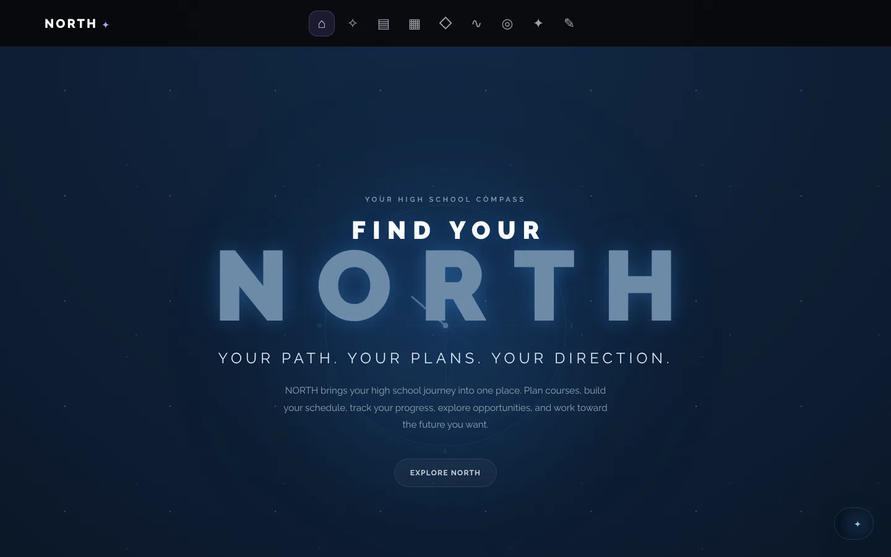
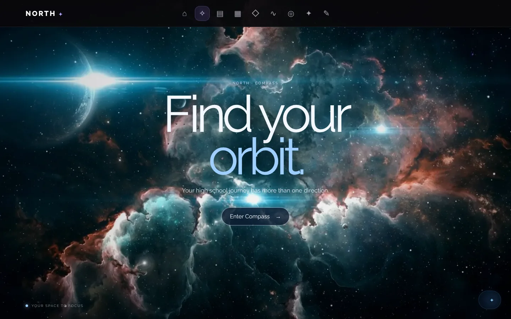
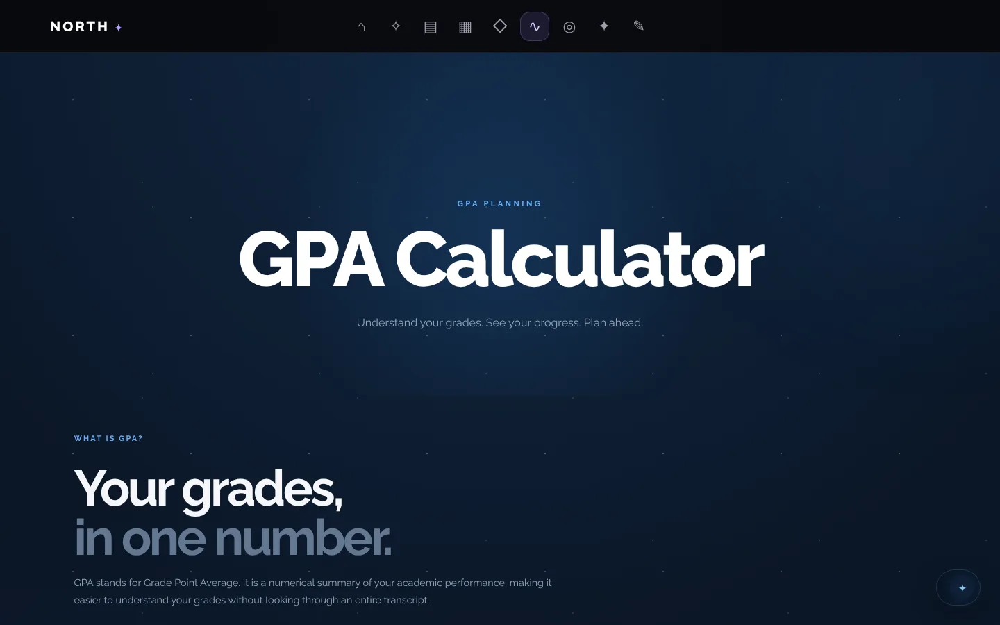

# North ✦

**Your high school compass.** North puts the main parts of planning high school on one site: choosing courses, building a schedule, understanding APs, tracking GPA, preparing for tests, finding opportunities and writing a resume.

**Live site:** https://north-ashen.vercel.app



## Why

High school planning advice is spread across counselor handouts, college websites, Reddit threads and older siblings. North gathers it in one place, with a calm space theme that makes planning feel less stressful.

## Features

| Page | Route | What it does |
| --- | --- | --- |
| **Home** | `/` | Landing page with an overview of what North covers. |
| **Compass** | `/compass` | A focus hub. Pick what you're working on (quick tasks, deep work, projects, creative work), run a Pomodoro-style **focus timer** with ambient space music and planet video backdrops, and earn stars that unlock **constellations**. |
| **Courses** | `/courses` | Typical high school courses by subject, plus how to read a college's Common Data Set to see what it values. |
| **Schedule** | `/schedule` | How to build a four-year plan around graduation requirements and career interests (CS, healthcare and more). Includes a downloadable **Excel schedule template**. |
| **AP Classes** | `/ap-classes` | What each AP covers, when students usually take it, and example AP sequences. |
| **GPA Calculator** | `/gpa` | Enter grades year by year (freshman through senior) to see weighted and unweighted GPA. |
| **Goals** | `/goals` | Set and track your own goals. They are saved in your browser. |
| **Test Prep** | `/test-prep` | ACT and PSAT/SAT strategy by section: English, Math, Reading and Science. |
| **Opportunities** | `/opportunities` | Extracurriculars, internships, research, cold emailing and summer programs, and how to find opportunities that aren't widely advertised. |
| **Resume Maker** | `/resume-maker` | Build a student resume from your activities, skills and programs. |
| **Send a signal** | `/submit-info` | A feedback form. Suggest resources or report problems. |

<p>
  
  
</p>

## Tech stack

- [React 19](https://react.dev/) + [Vite](https://vite.dev/)
- [React Router](https://reactrouter.com/) for client-side routing
- Plain CSS, one stylesheet per page
- [Supabase](https://supabase.com/) stores feedback form submissions
- `localStorage` for goals and constellation progress, so no account is needed
- [Playwright](https://playwright.dev/) for end-to-end browser tests
- Deployed on [Vercel](https://vercel.com/) with Vercel Web Analytics

## Getting started

You need [Node.js](https://nodejs.org/) 20.19+ or 22.12+.

```bash
git clone https://github.com/Amrutha-2028/north.git
cd north/north
npm install
cp .env.example .env.local   # then add your Supabase URL and publishable key
npm run dev
```

Then open http://localhost:5173.

Every page except the feedback form works without Supabase. If you want the form to work too, create a Supabase project with a `submissions` table that has these columns: `type`, `title`, `message` and `email` (nullable). Enable Row Level Security, and add a policy that allows anonymous `insert`.

### Scripts

Run these from the `north/` directory:

| Command | Description |
| --- | --- |
| `npm run dev` | Start the dev server with hot reload |
| `npm run build` | Production build into `dist/` |
| `npm run preview` | Serve the production build locally |
| `npm run lint` | Run ESLint |
| `npm run test:e2e` | Run the Playwright browser suite (Supabase is mocked) |

See [`north/tests/e2e/README.md`](north/tests/e2e/README.md) for test setup.

## Project structure

```
north/
├── public/            # logo, ambient music, planet videos, schedule template
├── src/
│   ├── pages/         # one component + stylesheet per route
│   ├── components/    # Navbar, Footer, FocusTimer, ConstellationCollection, ...
│   ├── lib/           # Supabase client, constellation reward logic
│   ├── App.jsx        # routes
│   └── main.jsx
└── tests/e2e/         # Playwright tests
```

## Roadmap

Ideas we're working toward (see [`north/thingstoadd.txt`](north/thingstoadd.txt)):

- A volunteer hours tracker
- A scholarships and financial aid guide
- Personalized weekly roadmaps
- A "coming up this month" feed of competitions, internships and scholarships
- Calendar integration
- Compass as a journey through forest, mountains, city and finally space

## Contributing

Issues and pull requests are welcome. Fork the repo, create a branch, and run `npm run lint` and `npm run test:e2e` before opening a PR.

## License

[MIT](LICENSE)
